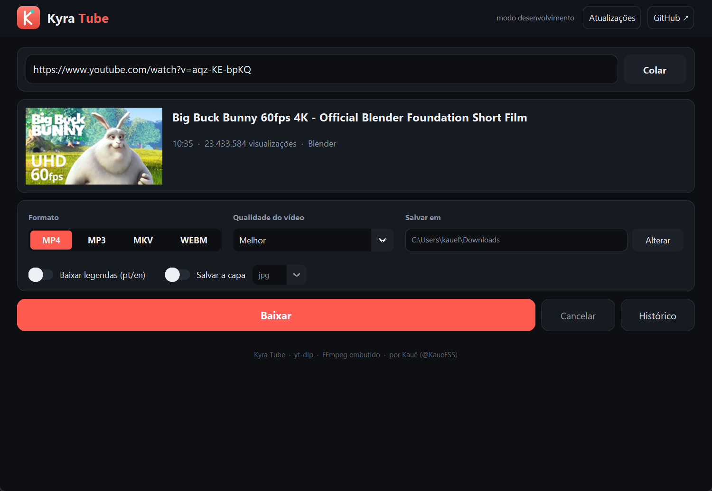
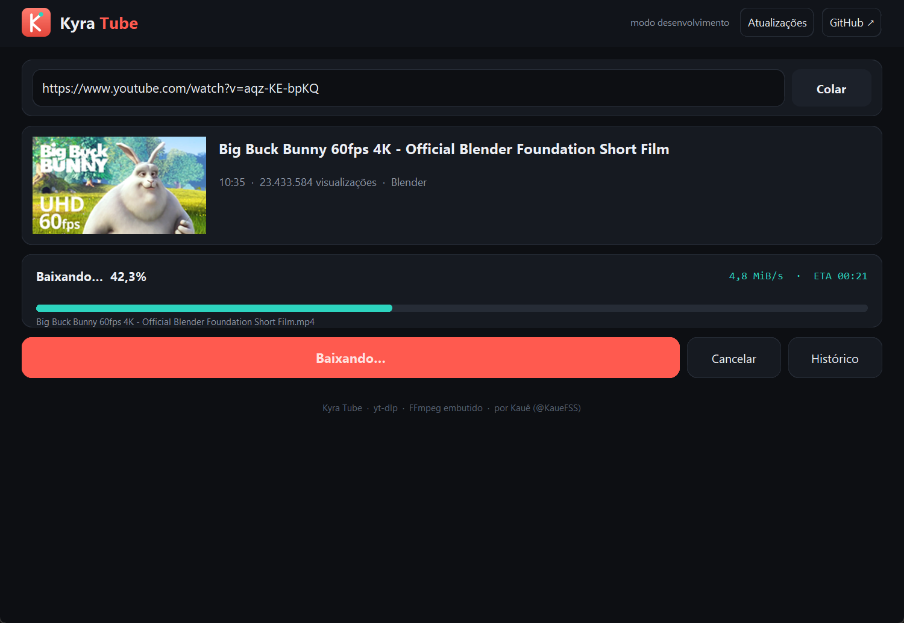
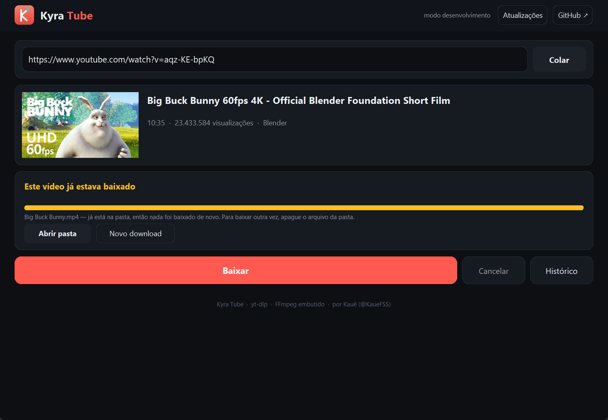
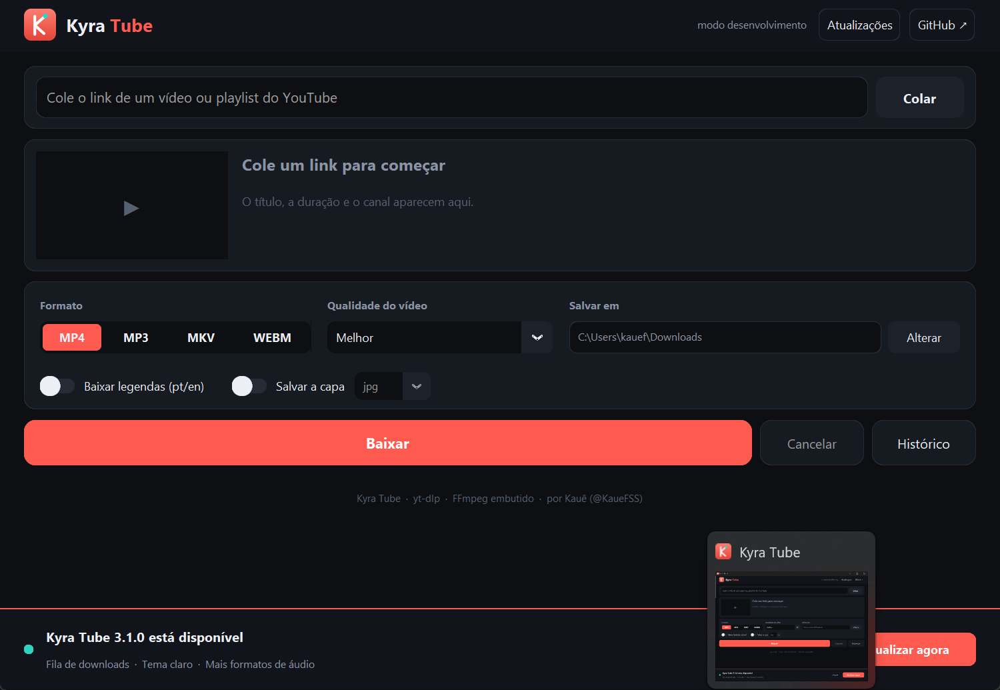

<div align="center">


# Kyra Tube

**Baixe vídeos e playlists do YouTube em MP3 ou MP4, com qualidade, rapidez e sem rastreio.**

[](https://github.com/KaueFSS/Kyra-Tube/releases/latest)
[](https://github.com/KaueFSS/Kyra-Tube/actions/workflows/ci.yml)


[](LICENSE)

[**Baixar para Windows**](https://github.com/KaueFSS/Kyra-Tube/releases/latest/download/Kyra-Tube-Setup.exe) &nbsp;·&nbsp; [Código-fonte](#rodar-pelo-código) &nbsp;·&nbsp; [Como atualiza](#atualização-automática) &nbsp;·&nbsp; [Privacidade](#privacidade)

<br />



</div>

<br />

## O que é

O Kyra Tube é um aplicativo de desktop para Windows: cole o link, escolha o formato e a qualidade, e baixe. Funciona com **vídeos e playlists inteiras**, mostra uma prévia antes de baixar, acompanha o progresso e a velocidade, e guarda um histórico do que você baixou.

Por baixo, usa o [yt-dlp](https://github.com/yt-dlp/yt-dlp) para obter e baixar o conteúdo e o [FFmpeg](https://ffmpeg.org) (já embutido) para converter. A interface é feita com [CustomTkinter](https://github.com/TomSchimansky/CustomTkinter).

> Faz parte da família **Kyra**, uma coleção de ferramentas pequenas e bem-cuidadas feitas por [Kauê](https://github.com/KaueFSS), como o [Kyra Plan](https://github.com/KaueFSS/Kyra-Plan).

## Recursos

<div align="center">

</div>

<br />


- **Vídeo** em MP4, MKV ou WebM, de 360p até 4K (ou a melhor qualidade disponível)
- **Áudio** em MP3 de 96 a 320 kbps
- **Playlists**: o app detecta e deixa você escolher quais vídeos baixar
- **Legendas** em português e inglês, quando existirem (inclusive as automáticas)
- **Thumbnail** salva em JPG, PNG ou WebP
- **Prévia** com título, duração, visualizações e canal antes de baixar
- **Progresso** por vídeo e da playlist inteira, com velocidade
- **Histórico** dos downloads
- **Avisa quando o vídeo já estava baixado**, em vez de fingir que baixou em 0 segundos
- **Explica os problemas** (vídeo privado, bloqueado, YouTube pedindo confirmação, internet instável) e diz o que tentar
- **Atualização automática**, com aviso e barra de progresso, sem janela de terminal

## Quando algo dá errado

Alguns vídeos simplesmente não podem ser baixados (privados, só para membros, bloqueados por direitos autorais ou por região), e às vezes o YouTube bloqueia a sua conexão por um tempo. Em vez de uma mensagem técnica em inglês, o app diz **o que aconteceu, por que costuma acontecer e o que tentar**, na ordem (como reiniciar o roteador para trocar o IP, que resolve muitos desses casos).

<div align="center">

</div>

<br />

Quando o arquivo já está na pasta, o app avisa e não baixa de novo:

<div align="center">

</div>

<br />

## Privacidade

O Kyra Tube **não coleta nem envia nenhum dado seu**. Não tem conta, não tem análise de uso, e o nome do seu usuário do Windows nunca sai do computador.

O app só fala com dois lugares: o **YouTube** (para baixar o que você pediu) e o **GitHub** (para saber se existe uma versão nova). O histórico fica num arquivo no seu próprio computador (`~/.kyra_tube.json`). E, como o código é aberto, você pode conferir isso lendo a pasta [`core/`](core).

## Atualização automática

<div align="center">

</div>

<br />

1. Ao abrir (e a cada 6 horas), o app consulta a última [release](https://github.com/KaueFSS/Kyra-Tube/releases) no GitHub.
2. Se houver versão nova, aparece um aviso embaixo da janela com as novidades. **Nada é baixado sem você clicar em "Atualizar agora".**
3. O instalador é baixado com barra de progresso e conferido pelo hash **SHA-256** publicado pelo GitHub.
4. Ele roda em modo silencioso, troca os arquivos e **abre o Kyra Tube de novo sozinho**. Seu histórico e suas preferências continuam onde estavam.

Esse mesmo caminho vale para quem compila o projeto: publicar uma versão é enviar uma tag, e o GitHub Actions gera o instalador e a release.

## Instalar

Baixe o [`Kyra-Tube-Setup.exe`](https://github.com/KaueFSS/Kyra-Tube/releases/latest/download/Kyra-Tube-Setup.exe) e execute. Instala só para o seu usuário (não pede administrador) e se atualiza sozinho dali em diante.

> Como o instalador ainda não tem certificado de editor pago, o Windows SmartScreen pode avisar na primeira vez: clique em **Mais informações → Executar assim mesmo**.

## Rodar pelo código

Precisa de Python 3.10 ou mais novo.

```bash
git clone https://github.com/KaueFSS/Kyra-Tube.git
cd Kyra-Tube
python -m venv .venv
.venv\Scripts\python -m pip install -r requirements.txt
.venv\Scripts\python main.py
```

Testes:

```bash
.venv\Scripts\python -m pip install -r requirements-dev.txt
.venv\Scripts\python -m pytest
```

Gerar o executável e o instalador (precisa do [Inno Setup 6](https://jrsoftware.org/isdl.php)):

```bash
powershell -ExecutionPolicy Bypass -File scripts\build.ps1
```

## Como o projeto é organizado

```text
main.py                  Ponto de entrada
core/                    Lógica, sem interface
  config.py              Nome, versão e endereço das releases
  downloader.py          Opções e execução do yt-dlp
  updater.py             Consulta, download, SHA-256 e instalação da atualização
  errors.py              Traduz os erros do yt-dlp para o que fazer
  history.py             Histórico (migra o arquivo da época do OffTube)
  setup.py               Dependências, FFmpeg e caminhos
ui/                      Interface (CustomTkinter)
  app.py                 Janela principal
  update_banner.py       Aviso de atualização
  error_dialog.py        Janela com o que aconteceu e o que fazer
  preview.py             Prévia do vídeo/playlist
  playlist_window.py     Escolha dos vídeos da playlist
  history_window.py      Janela do histórico
  progress_hooks.py      Progresso do download
installer/               Script do instalador (Inno Setup)
scripts/                 build.ps1, release.py, screenshots.py, smoke_download.py, smoke_ui.py
tests/                   Testes do atualizador, do histórico e das mensagens de erro
.github/workflows/       Testes e publicação das versões
```

## Lançar uma versão

```bash
python scripts/release.py 3.1.0
```

O script lê as novidades do [`CHANGELOG.md`](CHANGELOG.md), muda `APP_VERSION`, faz o commit, cria a tag e envia. O GitHub Actions roda os testes, gera o executável (PyInstaller) e o instalador (Inno Setup) e publica a release. Quem já usa o app recebe o aviso na próxima abertura. Com `--pre`, a release sai como pré-lançamento: dá para baixar e testar, mas o app não a oferece.

## Aviso legal

O Kyra Tube é uma ferramenta de software. Use de acordo com as leis do seu país e com os termos de serviço das plataformas acessadas, e baixe somente conteúdo para o qual você tenha autorização ou direito de uso. Os prints deste README usam o curta *Big Buck Bunny* (© Blender Foundation, [CC-BY](https://creativecommons.org/licenses/by/3.0/)).

## Autor

Feito por **Kauê** — [@KaueFSS](https://github.com/KaueFSS). Licença [MIT](LICENSE).
